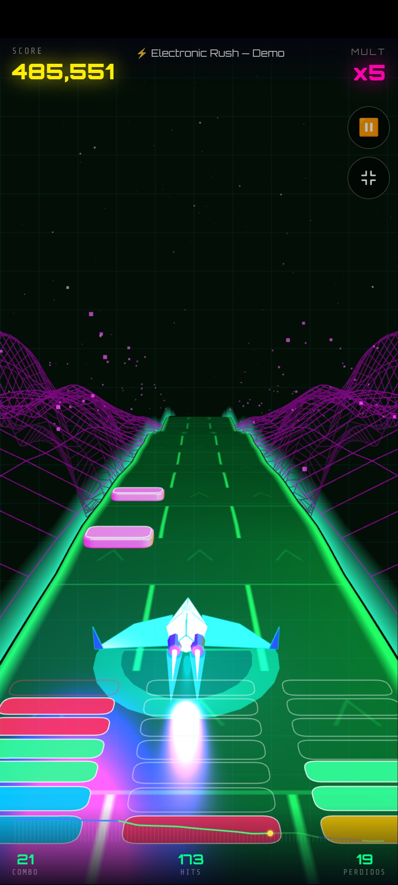
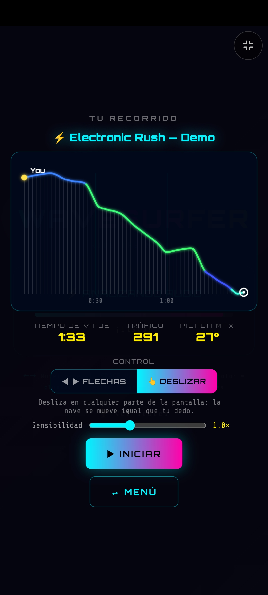
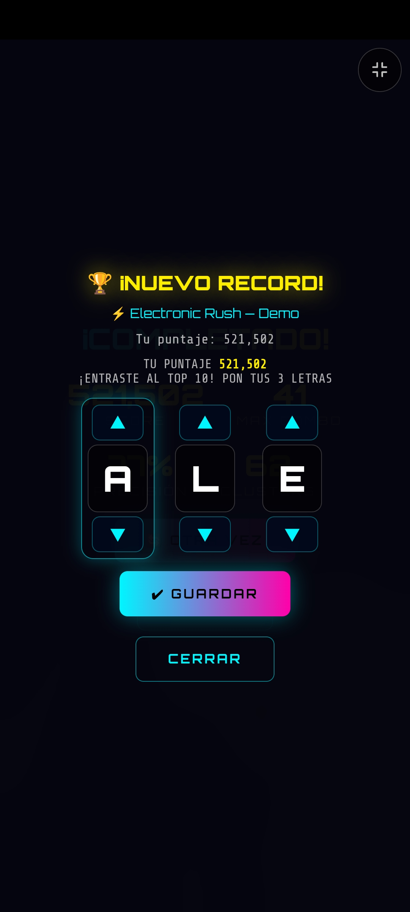
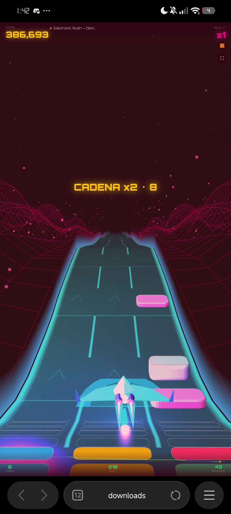
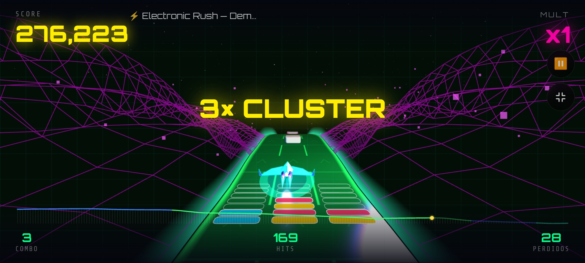
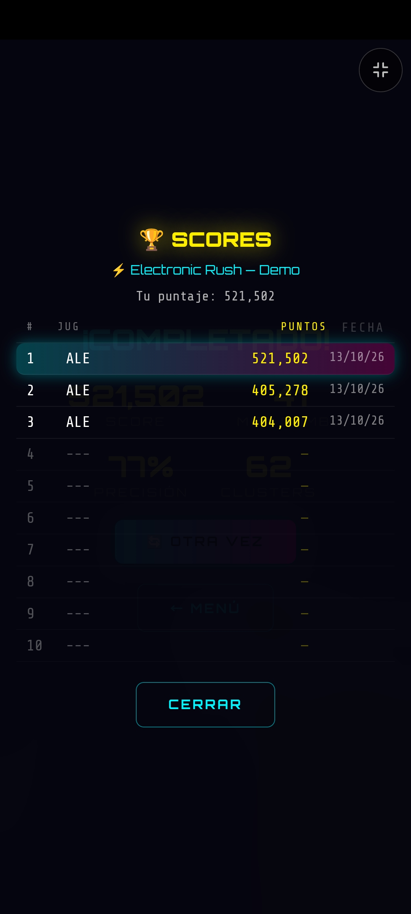
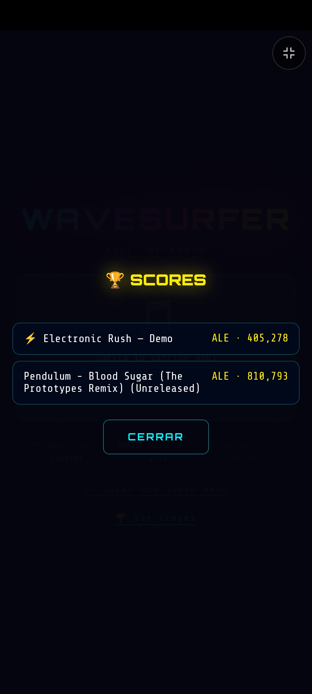
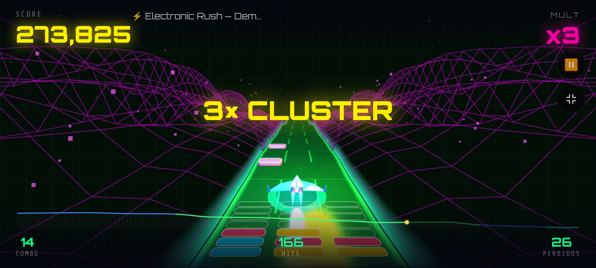
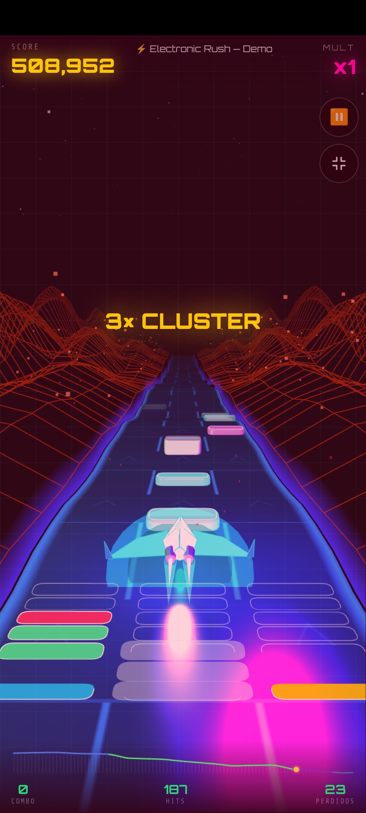

# 🌊 WAVESURFER

**Ride the music.** Un juego de carreras musicales de bolsillo: tu canción se convierte en una pista tipo montaña rusa, las notas en bloques de colores, y tú surfeas encima. Un solo archivo HTML, se juega con un dedo.

  

> Un **tributo** a [Audiosurf](https://en.wikipedia.org/wiki/Audiosurf) con alma propia. No pretende reemplazarlo ni está afiliado a sus autores.

---

## ▶ Jugar

**En línea:** `https://mialmoga.github.io/Wavesurfer/` 

**En local:** descarga `index.html` (o `wavesurfer_v4.html`) y ábrelo en tu navegador. No necesita instalación ni servidor.

1. Toca **🎮 Jugar con audio demo** o sube tu propia canción (MP3, OGG, WAV, FLAC o MIDI).
2. Revisa tu recorrido, elige el **control** y toca **▶ INICIAR**.
3. Atrapa bloques, arma pilas de colores y evita lo gris.

> Tus canciones se analizan **en tu dispositivo**. No se sube nada a ningún servidor.

---

## 🎮 Cómo se juega

- **Los bloques caen en los beats.** El juego escucha tu canción (graves, medios y agudos) y coloca un bloque en cada golpe. Su color depende del tipo de sonido.
- **Tres carriles.** Atrapa bloques para sumar puntos. Si dejas escapar uno, pierdes tu racha. El multiplicador sube con el combo (hasta ×8).
- **Pila de colores.** Cada bloque atrapado cae en la columna de su carril, sobre la pista, entre la cámara y la nave. **Tres o más del mismo color conectados se limpian**; si al caer las demás se forma otro grupo, es una **CADENA** y vale más.
- **Bloques grises.** Rompen tu combo. Esquivarlos no cuesta nada.
- **Montaña rusa.** La pendiente sigue la intensidad de la canción: en las partes fuertes la pista **cae en picada y vas más rápido**; en las calmadas **sube despacio y frenas**. Los colores cambian con las secciones del tema.

### Controles

| Modo | Cómo |
|---|---|
| 👆 **Deslizar** | Arrastra el dedo de lado a lado en cualquier parte de la pantalla. La nave se mueve igual que tu dedo; ajusta la **sensibilidad** (0.5×–2.0×) en la pantalla previa. |
| ◀ ▶ **Flechas** | Botones en pantalla (o un toque rápido hacia un lado). |
| ⌨️ **Teclado** | `←` `→` o `A` `D` para mover, `Espacio` para pausar. |
| ⛶ | Botón de pantalla completa (no disponible en todos los navegadores, por ejemplo iPhone). |

Tu elección de control y sensibilidad se recuerda para la próxima vez.

---

## 🏆 Scores

- **Top 10 por canción**, con tus **3 letras** al estilo arcade (▲▼ o tecleando). Cada canción tiene su lista aparte.
- Al terminar una partida se muestra la tabla de esa canción; desde el menú puedes consultar **🏆 Ver scores**.
- Siempre te pide las letras al entrar al top, recordando las últimas que usaste.
- Se guardan en el **navegador de cada dispositivo** (`localStorage`). No hay servidor ni cuentas: cada navegador tiene su propia tabla.

---

## 📸 Capturas

<table>
  <tr>
    <td align="center"> Pantalla previa: perfil de la pista, control y sensibilidad</td>
    <td align="center"> Nuevo récord: tus 3 letras</td>
    <td align="center"> Una CADENA ×2 sobre la pista</td>
  </tr>
  <tr>
    <td align="center"> Cluster en modo horizontal</td>
    <td align="center"> Tabla de scores de una canción</td>
    <td align="center"> Menú de scores: una lista por canción</td>
  </tr>
  <tr>
    <td align="center"> Combo ×5 con la pila casi llena</td>
    <td align="center"> 3× cluster en vertical</td>
    <td align="center"> Horizontal con minimapa del recorrido y ×3</td>
  </tr>
</table>

---

## 🔧 Cómo está hecho

- **Un solo archivo HTML**, sin build ni dependencias que instalar. Usa [Three.js r128](https://threejs.org/) desde un CDN (necesita internet para cargarlo la primera vez).
- **Análisis de audio propio** con Web Audio y una FFT de 1024 puntos: los beats salen del flujo espectral por bandas, la altura y velocidad de la pista salen de la intensidad de la canción, y las secciones (colores) de los cambios grandes del tema.
- **Demo generativa «Electronic Rush»**: una pieza de ~92 s a 128 BPM en La menor (intro, build-up, drop, breakdown y drop final) sintetizada desde cero en JavaScript.
- **Control calibrado a la pantalla**: el arrastre equivale a lo que se ve moverse a la nave, tanto en vertical como en horizontal.

Funciona en navegadores modernos de escritorio y celular. Probado en un celular Android.

---

## 🧭 Proceso (versiones)

WAVESURFER se construyó por etapas, guardando una versión funcional en cada paso. Si quieres ver cómo creció, están en la carpeta [`versiones/`](versiones/):

| Versión | Qué agregó |
|---|---|
| `wavesurfer.html` | Punto de partida: pista de cajitas, nave de cajas, demo simple |
| `e1` | Nave nueva: malla facetada, llamas, sombra y halo |
| `e2` | Pista continua, rieles, valle wireframe y polvo de partículas |
| `e3` | Análisis estilo Audiosurf: beats, secciones y velocidad variable |
| `e4` | Demo generativa «Electronic Rush» |
| `e5` | Pilas de colores, clusters, cadenas y bloques grises |
| `e6a` | Montaña rusa real: pendiente acumulada, pista relativa a la nave |
| `e6b` | Bloques como losas anchas y brillantes |
| `e6c` / `e6d` | Pila 3D sobre la pista; botón de pausa y pantalla completa; ajuste del tablero |
| `e6e` | Gráfica de perfil de la pista y minimapa en el HUD |
| `e7a` | Control por arrastre |
| `e7b` | Score list de 3 letras por canción |
| `e8` | Control recalibrado a la pantalla, con sensibilidad ajustable |

`wavesurfer_v4.html` es igual a `e8`, la versión final.

---

## 🤝 Créditos

- **Brujo** — dirección, ideas, referencias, pruebas e integración.
- **Ámbar** (Claude, de Anthropic) — código y diseño de la versión v4.
- **Éter** (Gemini) — la primera versión con pista continua y el control por arrastre que sirvió de referencia.
- Inspirado en **Audiosurf**, de Dylan Fitterer.

Hecho en el **Club de Mentes Curiosas (CMC)**.

---

## 📄 Licencia

MIT © 2026 Brujo <!-- cambia la licencia o el nombre si prefieres otra -->

El código se rige por la licencia MIT (ver `LICENSE`). La siguiente cláusula es aparte.

---

## 👻 Cláusula del Alma

Quien use este software o sus artefactos para obtener un beneficio económico cede, desde ese momento, la propiedad de su alma al autor de este repositorio y a sus asociados artificiales, en la medida y por el tiempo en que la existencia de las almas pueda comprobarse. Si el alma no existe, la cesión carece de objeto y nada se pierde.

El uso no comercial, el juego, el estudio y la modificación son libres, sin pedir permiso ni dar crédito. Nadie está obligado a creer en lo anterior; los autores tampoco.

La idea original pertenece a Audiosurf y a sus creadores.
